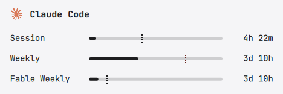

# omarchy-agents

An Omarchy bar widget (`zoltanf.agents`, "Agents & Forecast") that replaces the
stock `omarchy.agents`. It is Omarchy's own Agents panel (usage, rate limits
and prepaid balances for your AI subscriptions), with a forecast added to the
limit meters.



The stock meters show how much of a window you have used, but not whether you
will run out before it resets. 35% of a weekly limit is fine with one day gone
and a problem with six days gone.

- **Forecast line:** each limit with a time window and a reset time (Session,
  Weekly, Monthly) gets a dotted line where its usage lands at the reset
  if you keep the average rate since the window opened (used ÷ share of the
  window elapsed). The line is drawn in the text color up to a 50% forecast
  and turns gradually red from there, fully red at 100%. Past 100%, the line sits at the end of the bar. It stays
  hidden for the first 5% of a window, where a single prompt swings it.
  Balances and limits without a reset time get no line.
- **Hover:** a meter's tooltip adds the number, for example
  `On pace for 140% at reset`. When that passes 100%, it also says when the
  limit fills up, for example `Full by Mon 2:38 AM, 2d 5h before reset`.
  Weekly and Monthly limits also show how much more can go before midnight
  while staying on an even pace to 100% at the reset, for example
  `27% left today to stay under 100%` (hidden at 0% or below). The pace
  counts from the start of the window, so days that used less add to today.
  Below that is how much is left per day until the reset, for example
  `24% a day for 2.4 days to stay under 100%` (not in the last day).
- **Model limits as their own bars:** a model-scoped limit such as Claude's
  "Fable Weekly" gets its own row, bar and forecast, right under the window
  it shares a clock with. The stock widget draws it as a small marker on that
  window's bar.
- **Private sync snapshot:** with sync on (`syncMode`, see
  [README.omarchy.md](README.omarchy.md)), this machine's usage snapshot is
  readable by you only (mode 600), and so are the folders the widget creates
  for it (700). The stock widget leaves both readable by other local
  accounts at the usual umask (022). A sync folder that already exists keeps
  its mode.

Everything else works as in the stock widget; its documentation is in
[README.omarchy.md](README.omarchy.md).

## Install

```sh
omarchy plugin add https://github.com/zoltanf/omarchy-agents.git --enable
```

The plugin declares itself a replacement for `omarchy.agents`
(`"clonedFrom": "omarchy.agents"` in `manifest.json`), so enabling it puts it
in the stock widget's place in the bar.

## Removal

To go back to the stock widget, disable this one:

```sh
omarchy plugin disable zoltanf.agents
```

To uninstall it completely:

```sh
omarchy plugin remove zoltanf.agents
```

## License

MIT. The code comes from Omarchy's own Agents widget and keeps its MIT notice
(© David Heinemeier Hansson, [LICENSE.omarchy](LICENSE.omarchy)).
